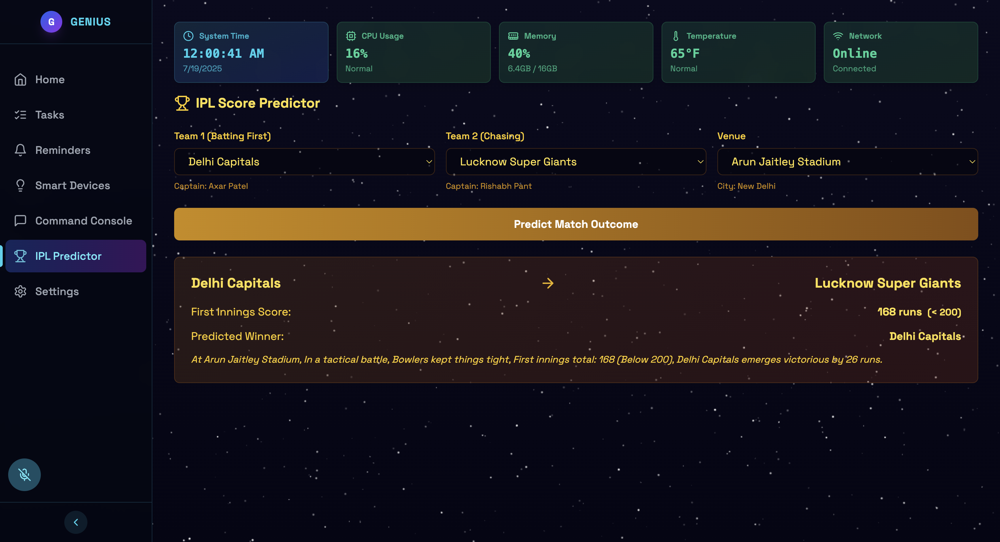
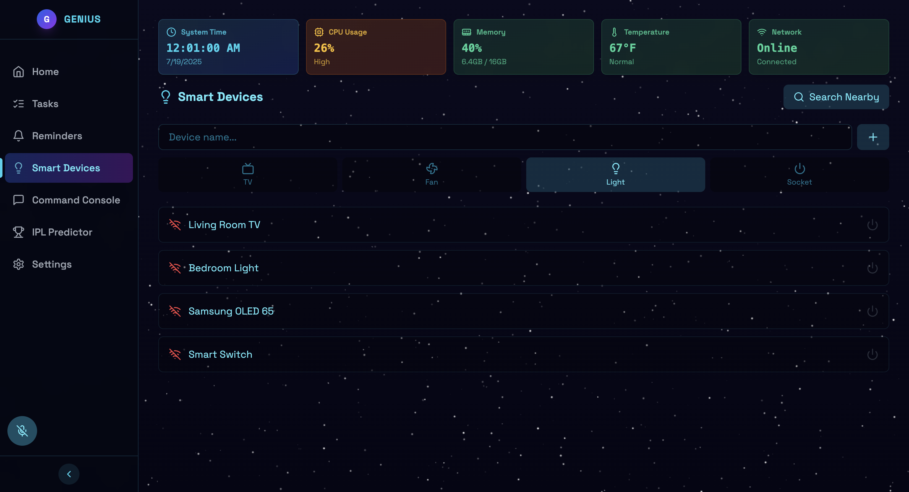
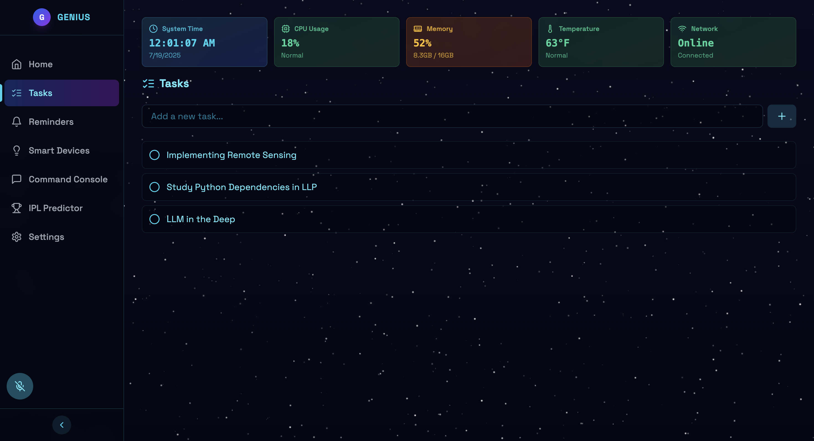
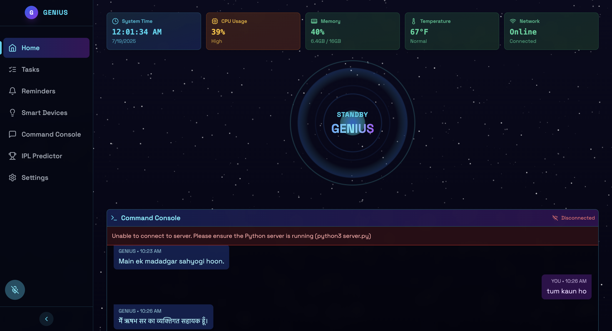

# 🤖 Genius AI Assistant

Genius is a **multilingual AI-powered voice assistant**.  
It can understand your voice commands (English or Hindi), open applications, search the web, provide smart reminders, predict IPL scores, and perform various tasks using advanced AI models.

> **Tech Stack:** Python (Flask), SpeechRecognition, OpenAI (via OpenRouter), Langdetect, Web APIs.

---

## ✨ Features

✅ **🎙️ Voice Recognition** – Listens to your voice and converts speech to text.  
✅ **🌐 Multilingual Support** – Understands and responds in **English** and **Hindi** (auto-detects language).  
✅ **💻 Application Control** – Open Chrome, VS Code, YouTube, and more via simple voice commands.  
✅ **🔍 Web Search** – Say “search …” and it instantly opens Google search results.  
✅ **📊 IPL Score Predictor** – Get match predictions and insights (custom module can be integrated).  
✅ **⏰ Smart Reminders** – Set reminders and get notified (integrate with scheduling).  
✅ **🧠 Predefined Responses** – Quick replies for common questions like “Who made you?”, “What’s your purpose?” etc.  
✅ **🤖 AI-Powered Answers** – For other queries, it connects to **LLaMA-3.3** via OpenRouter API and gives intelligent answers.  
✅ **⚡ Always Learning** – Built to be extendable with plugins for new tasks.

---

## 🚀 Installation

### 📥 1. Clone the Repository
```bash
git clone 
cd genius-ai-assistant
```

### 🐍 2. Set up Python Environment
Make sure you have **Python 3.9+** installed.
```bash
python3 -m venv venv
# Activate the virtual environment
source venv/bin/activate   # ✅ On macOS/Linux
venv\Scripts\activate      # ✅ On Windows
```

### 📦 3. Install Dependencies
Install all required libraries:
```bash
pip install -r requirements.txt
```

**Example `requirements.txt`:**
```
Flask
flask-cors
SpeechRecognition
openai
langdetect
pyaudio
```

> 💡 **Note:** For `pyaudio`, install system-level packages if needed:  
> • **macOS:** `brew install portaudio`  
> • **Windows:** `pip install pipwin && pipwin install pyaudio`  
> • **Linux:** `sudo apt-get install portaudio19-dev`

### 🔑 4. Configure API Key
Create a `config.py` file in the project root with:
```python
OPENROUTER_API_KEY = "your_openrouter_api_key_here"
```
👉 Get your API key from [https://openrouter.ai](https://openrouter.ai).

### ▶️ 5. Run the Server
```bash
python server.py
```

🌐 The Flask server will start at:  
```
http://localhost:5001
 
## 📡 API Endpoints

| Endpoint | Method | Description |
|----------|--------|-------------|
| `/api/health` | GET | Health check |
| `/api/listen` | POST | Captures microphone input, processes voice, and returns AI response |
| `/api/chat` | POST | Accepts JSON `{ "text": "your query" }` and returns AI response |

**Example with `curl`:**
```bash
curl -X POST http://localhost:5001/api/chat \
     -H "Content-Type: application/json" \
     -d '{"text": "who made you"}'
```

---

## 🎯 Usage

- **Voice Mode:** Run the server and hit `/api/listen` to capture microphone input.
- **Chat Mode:** Use `/api/chat` with a text query.

---

## 🛠️ Adding New Features

- Add more **predefined responses** inside `predefined_responses()` in `server.py`.
- Add new app launchers in the `apps` dictionary inside `open_application()`.
- Integrate reminders or IPL APIs within `handle_query()`.

---

## 📌 Roadmap

- ✅ Voice commands (English & Hindi)
- ✅ Web search & app control
- ✅ AI-based chatting
- 🔜 IPL live score integration
- 🔜 Smart reminder scheduling with notifications
- 🔜 IoT device control and home automation

---

## 🙌 Acknowledgements

- **OpenRouter API** for powerful AI models.
- **SpeechRecognition** library for STT (speech-to-text).
- **Flask** for backend server.
- **Langdetect** for automatic language detection.

---

**✨ Genius — Your multilingual AI assistant at your command!**

## 🖼️ Demo Screenshots

Here are some demo images of **Genius AI Assistant** in action:





