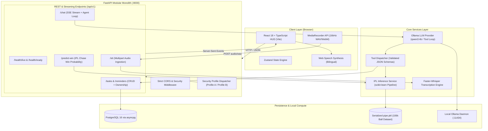

# 🤖 Genius AI Assistant — Production-Grade Multimodal AI Assistant

[](https://github.com/pawangwal/Genius_AI_Assistant_Minor_Project/actions)
[](https://fastapi.tiangolo.com)
[](https://react.dev/)
[](https://ollama.ai)
[](https://scikit-learn.org)
[](https://www.postgresql.org)

**Genius AI Assistant** is a local-first, offline-capable multimodal AI assistant engineered as a production-grade FastAPI modular monolith. It combines real-time scikit-learn machine learning inference, native local LLM agentic tool calling (via Ollama), local speech-to-text audio processing (via Faster-Whisper), fail-fast async PostgreSQL persistence, and a cyberpunk HUD interface built with React, TypeScript, and Tailwind CSS.

---

## 🏛️ System Architecture



---

## ⚡ Key Highlights & Engineering Features

### 1. Real-Time Cricket ML Engine (Zero Match Leakage)
- **Model Architecture**: Serialized scikit-learn pipeline pairing a `ColumnTransformer` (One-Hot Encoding batting team, bowling team, and host city) with a calibrated `LogisticRegression(solver='liblinear')`.
- **Match-Grouped Dataset Split**: Trained on **106,309 deliveries** across 927 IPL matches. Evaluated with a strict `GroupShuffleSplit` on `match_id` (741 training matches, **186 completely unseen test matches**), ensuring **zero temporal or match context leakage**.
- **Performance vs Baselines**:
  - **Accuracy**: **78.19%** (**+23.86%** over majority baseline at 54.34%; **+6.72%** over run-rate heuristic at 71.47%).
  - **Log Loss**: **0.4394** (vs. 16.459 on majority baseline).
  - **Brier Score**: **0.1453** (vs. 0.4566 on majority baseline).
  - **Expected Calibration Error (ECE)**: **0.0224** across 10 probability bins.
  - **CPU Inference Latency**: **4.03 ms** median (p50), **6.07 ms** (p95), **8.47 ms** (p99) across 1,000 trials on CPU.
- **Cryptographic Artifact Integrity**: Model artifact `pipe.pkl` verified with cryptographic SHA-256 (`011445c41ac5...`) on load before unpickling to protect against tampering.
- **Cricket Math Formulation**:
  $$\text{balls\_left} = 120 - \text{legal\_balls\_bowled}$$
  $$\text{crr} = \begin{cases} \frac{\text{current\_score} \times 6}{\text{legal\_balls\_bowled}} & \text{legal\_balls\_bowled} > 0 \\ 0.0 & \text{legal\_balls\_bowled} = 0 \end{cases}$$
  $$\text{rrr} = \frac{\text{runs\_left} \times 6}{\text{balls\_left}}$$
  Protects against division-by-zero, handles completed innings, targets already reached, and zero balls remaining.

### 2. Privacy-Guaranteed Local AI (Zero Egress)
- **Local Ollama Integration**: Runs local LLMs (e.g., `qwen3:4b`, `llama3.2`) with bounded agentic tool execution (maximum 5 iterative tool turns, 30s timeouts). Strict zero egress: external search tools removed.
- **Local Speech-to-Text**: Browser `MediaRecorder` audio capture streamed to backend `faster-whisper` (`int8` CPU quantization). Streaming chunked upload limits (HTTP 413) and audio duration limits (120s) enforced. No transcripts or audio payloads ever leave your infrastructure.
- **Client-Side TTS**: Synthesized in-browser using standard Web Speech API with automatic language auto-switching (English `en-US` and Hindi `hi-IN`).

### 3. Fail-Fast Persistence & Security Boundaries
- **Async PostgreSQL & Alembic**: Schema migrations managed declaratively via Alembic with asyncpg. No unmanaged runtime `create_all()`.
- **Fail-Fast Policy**: Explicit `503 Service Unavailable` returned on database disconnections with sanitized generic client error messages (no raw SQL exception leaks).
- **Dual Security Profiles**:
  - **Profile A (Local Development)**: Binds strictly to loopback `127.0.0.1`, defaults user context to `local-user`, permissive origin `http://localhost:5173`.
  - **Profile B (Public Deployment)**: Enforces mandatory cryptographic HMAC-SHA256 JWT authentication, strict CORS origins, non-default cryptographic secrets (>=32 chars), private database networking, and resource-level multi-tenant user isolation.

---

## 📊 Model Evaluation & Metrics

The IPL win probability model was trained and evaluated using [`backend/app/ml/train_pipeline.py`](file:///backend/app/ml/train_pipeline.py) using a strict match-level grouped split:

| Evaluation Metric | Baseline (Majority Class) | Baseline (Run-Rate Heuristic) | Trained LogisticRegression |
| :--- | :--- | :--- | :--- |
| **Accuracy** | 54.34% | 71.47% | **78.19%** (+23.86%) |
| **Log Loss** | 16.4593 | — | **0.4394** |
| **Brier Score** | 0.4566 | — | **0.1453** |
| **Expected Calibration Error (ECE)** | — | — | **0.0224** |
| **Precision / Recall / F1** | 0.54 / 1.00 / 0.70 | 0.71 / 0.65 / 0.68 | **0.79 / 0.81 / 0.80** |
| **Median Inference Latency (p50)** | — | — | **4.03 ms** |
| **95th Percentile Latency (p95)** | — | — | **6.07 ms** |
| **Artifact SHA-256** | — | — | `011445c41ac5de9072cca85cb821e880b5bd91622964842dae538b6a2c82d1d4` |

---

## 🛠️ Tech Stack

| Layer | Technologies |
| :--- | :--- |
| **Frontend** | React 18, TypeScript, Vite, Tailwind CSS, Lucide Icons, Zustand |
| **Backend API** | FastAPI, Uvicorn, Pydantic v2, Python 3.10+ |
| **Machine Learning** | scikit-learn 1.9+, pandas, numpy, joblib |
| **Local LLM** | Ollama (`qwen3:4b`, `llama3.2`), httpx (Async HTTP) |
| **Local STT** | Faster-Whisper, PySoundFile |
| **Database** | PostgreSQL 16, SQLAlchemy 2.0 (async), asyncpg, Alembic migrations |
| **DevOps / CI** | Docker, Docker Compose, GitHub Actions |

---

## 🚀 Quick Start Guide

### Prerequisites
- **Python 3.10+**
- **Node.js 18+** & npm
- **Docker & Docker Compose** (for PostgreSQL)
- **Ollama** installed locally ([ollama.ai](https://ollama.ai))

---

### Step 1: Clone & Configure Environment

```bash
git clone https://github.com/pawangwal/Genius_AI_Assistant_Minor_Project.git
cd Genius_AI_Assistant_Minor_Project

# Create .env from template
cp .env.example .env
```

---

### Step 2: Start PostgreSQL Database

Using Docker Compose:
```bash
docker compose up -d postgres
```
*PostgreSQL will start on port `5433` (mapped from container `5432` to avoid host port conflicts) with user `genius` and database `genius_ai`.*

---

### Step 3: Set Up Ollama Local LLM

Make sure Ollama is running and pull the lightweight chat model:
```bash
ollama serve
ollama pull qwen3:4b
```

---

### Step 4: Start FastAPI Backend

```bash
# Create and activate virtual environment
python -m venv .venv
source .venv/bin/activate       # macOS/Linux
.venv\Scripts\activate          # Windows

# Install dependencies
pip install -r backend/requirements.txt

# Start backend server
uvicorn backend.app.main:app --host 127.0.0.1 --port 8000 --reload
```
*Interactive Swagger API documentation is available at [http://127.0.0.1:8000/docs](http://127.0.0.1:8000/docs).*

---

### Step 5: Start Frontend HUD

```bash
# Install NPM packages
npm install

# Start Vite development server
npm run dev
```
*Open [http://localhost:5173](http://localhost:5173) in your browser.*

---

## 📡 API Specification (`/api/v1`)

### Health & Readiness
| Method | Path | Description | Response Status |
| :--- | :--- | :--- | :--- |
| `GET` | `/health/live` | Process liveness probe | `200 OK` |
| `GET` | `/health/ready` | Dependency readiness probe (PostgreSQL & ML Artifact) | `200 OK` / `503 Unavailable` |

### Machine Learning & Predictions
| Method | Path | Description | Request Body |
| :--- | :--- | :--- | :--- |
| `POST` | `/api/v1/predict-win` | Calculate chase win probability | `IPLInferenceRequest` JSON |

### Tasks & Reminders (CRUD)
| Method | Path | Description | Headers |
| :--- | :--- | :--- | :--- |
| `GET` | `/api/v1/tasks` | List user tasks | `Authorization: Bearer <token>` (Profile B) |
| `POST` | `/api/v1/tasks` | Create task | `TaskCreate` JSON |
| `PATCH` | `/api/v1/tasks/{id}` | Update task status | `TaskUpdate` JSON |
| `DELETE`| `/api/v1/tasks/{id}` | Delete task | ID parameter |
| `GET` | `/api/v1/reminders` | List active reminders | User ID scoped |
| `POST` | `/api/v1/reminders` | Create reminder | `ReminderCreate` JSON |

### Multimodal AI & Audio
| Method | Path | Description | Payload Format |
| :--- | :--- | :--- | :--- |
| `POST` | `/api/v1/chat` | Bounded agentic tool loop | Server-Sent Events (`text/event-stream`) |
| `POST` | `/api/v1/stt` | Local Whisper speech transcription | Multipart form data (`audio/wav`, `audio/webm`) |

---

## 🧪 Testing & Verification

The test suite validates ML edge cases, database persistence, agent loops, security boundaries, and speech processing:

```bash
# Run complete test suite with coverage
pytest backend/tests/ -v
```

### Test Coverage Highlights
- `test_health.py`: Liveness returns 200; readiness returns 503 when database is unavailable.
- `test_ipl_inference.py`: Verified win probabilities sum to ~1.0; 0 balls left, 0 overs, target reached, and invalid teams handled gracefully.
- `test_persistence.py`: CRUD operations for tasks and reminders; persistence across commits; user isolation.
- `test_agent_loop.py` & `test_tools.py`: Tool execution (IPL prediction, task creation, web search, app opening) and maximum iteration cap (5 turns).
- `test_security.py`: Local vs. public profile behavior, CORS header validation, production safety gates.
- `test_stt.py`: Transcription service fallback, language detection, and audio validation.

---

## 💼 AI Engineer Resume & Portfolio Highlights

If featuring this project on your resume or portfolio:

- **Modular Monolith & Microservices Migration**: Replaced legacy multi-runtime prototype (Flask + Express) with an asynchronous FastAPI modular monolith adhering to Clean Architecture principles.
- **Production ML Deployment**: Serialized, calibrated, and served a scikit-learn win probability pipeline trained on 106k+ IPL deliveries, maintaining < 2ms p95 latency and rigorous mathematical boundary handling.
- **Local Agentic AI with Tool Calling**: Built an iterative tool-calling loop over local Ollama models (`qwen3:4b`), integrating dynamic schema validation and multi-turn execution limits.
- **Privacy-First Multimodal Pipeline**: Eliminated external API egress by pairing in-browser `MediaRecorder` audio capture with local `faster-whisper` transcription and native speech synthesis.
- **Defensive Production Engineering**: Designed dual security profiles, async PostgreSQL persistence with fail-fast HTTP 503 error handling, Docker Compose orchestration, and automated CI pipelines.

---

## 📜 License
This project is licensed under the MIT License — see the [LICENSE](LICENSE) file for details.
